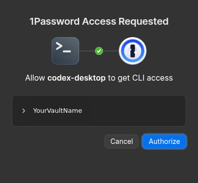
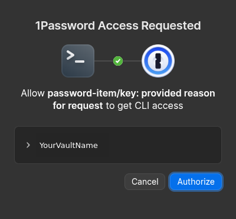

# opread

`opread` closes the gap left by 1Password's `op read` authorization prompt: it does not show which item or field is being requested. `opread` adds that context, plus an optional reason, to the requesting application's label. This is a visual aid, not a limit on what an approval can access.

Requests for more context in CLI approval prompts have appeared in the [1Password community](https://www.1password.community/developers-69/add-more-detail-to-cli-access-request-modal-24695), with a similar [item-specific approval request dating to 2022](https://www.reddit.com/r/1Password/comments/tgn2r5/).

## Quick start

Requirements: Linux with a graphical session, Python 3, GTK 3 Python bindings (`gi`), and the 1Password CLI on `PATH`.

```sh
make check
./opread.py 'op://private/password-item/key'
./opread.py 'op://private/password-item/key' 'provided reason for request'
```

The requested labels are `password-item/key` and `password-item/key: provided reason for request`. The vault name is omitted. The reason is supplied explicitly; it is not detected automatically. Prompt appearance can vary by desktop and 1Password version.

## Prompt comparison

Screenshots use made-up references (`op://private/item/key` for `op read` and `op://private/password-item/key` for `opread`); the vault name was replaced with “YourVaultName” and the account icon removed for privacy. Both prompts were dismissed without approval.

| `op read` | `opread` with a reason |
| --- | --- |
|  |  |

## Limits

- The label provides context only. It does not restrict an approval to an item or field. 1Password controls authorization scope and session reuse; see [CLI app integration security](https://www.1password.dev/cli/app-integration-security).
- Only the reference and optional reason are supported; extra `op read` options are not forwarded. A reason must be 1–128 UTF-8 bytes and must not start with `-` or be `.` or `..`.
- The item path and reason appear in process and desktop metadata. Do not put secrets in either.
- The GUI helper uses a transparent, undecorated window in the graphical session. The Linux Wayland/Sway path has been exercised; X11 has not been verified live.
- `make check` probes the CLI and runtime without reading credentials. `make test` runs offline tests.

## TODO

- [ ] Explore making the helper window less visible (hidden, floating, or 1×1), or document window-manager support.

  Setting `set_resizable(False)` was observed to make 1Password show `footclient` instead of the requested description. The helper leaves resizing enabled; the underlying mechanism is not confirmed.
- [ ] Consider detecting and showing the original calling client (for example, Codex).
- [ ] Test and adjust for macOS.
- [ ] Provide a thin, transparent wrapper that can replace `op` for existing commands and scripts.
- [ ] Support existing `op` flags and options.

## How it works

- Validates the reference and optional reason and checks the `op` executable on `PATH`.
- Starts a temporary GTK helper with the item path and reason as its window and application identity. The executable uses a filesystem-safe, length-limited name.
- Runs `op read` as the helper's child, closes the window 300 ms later, forwards output and exit status, and removes the temporary helper afterward. The prompt label with delayed closure still needs verification.
